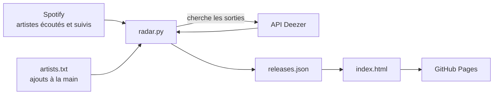

# radar-musique

# radar-musique

Chaque matin, ce projet récupère les artistes que j'écoute sur Spotify, cherche leurs sorties des 7 derniers jours (albums, EP, singles) et les publie sur une page web.

**Le site : https://antoinelongour.github.io/radar-musique/**

## Ce que fait le site

- Affiche les sorties de la semaine, regroupées par jour, avec la pochette, le titre et les artistes.
- Filtre par type : albums, EP ou singles.
- Ouvre la sortie sur Spotify en un clic.
- Retire les doublons : versions multiples d'un même titre, featurings entre artistes suivis, singles déjà présents sur l'album de la semaine.
- Se met à jour tout seul chaque matin, sans serveur et gratuitement.

## Comment ça marche



1. **Qui j'écoute** : le script récupère sur l'API Spotify mes 50 artistes les plus écoutés sur les 4 dernières semaines et sur les 6 derniers mois, ainsi que tous les artistes que je suis. Il y ajoute ceux de `artists.txt`.
2. **Quoi de neuf** : pour chaque artiste, il cherche sa discographie sur l'API Deezer, qui ne demande ni compte ni clé, et garde les sorties des 7 derniers jours.
3. **Publication** : le résultat est écrit dans `releases.json`, que la page `index.html` affiche.
4. **Automatisation** : GitHub Actions lance le script chaque matin vers 6 ou 7 h (heure de Paris) et republie le site sur GitHub Pages. Il le fait aussi à chaque modification poussée sur le repo.

Pourquoi Deezer pour les sorties ? Depuis février 2026, l'API Spotify en mode développeur ne propose plus la liste des nouveautés, et Deezer reçoit les sorties directement des labels, le jour même.

## Fichiers du projet

| Fichier | Rôle |
|---|---|
| `radar.py` | Le script principal : récupère les artistes, cherche les sorties, écrit `releases.json`. |
| `index.html` | La page web qui affiche les sorties. |
| `releases.json` | Les sorties de la semaine, générées par `radar.py`. |
| `artists.txt` | Artistes ajoutés à la main, un par ligne. Toujours pris en compte, même sans Spotify. |
| `spotify_token.py` | Script à lancer une seule fois pour autoriser l'accès à Spotify. |
| `requirements.txt` | Les bibliothèques Python nécessaires (`requests`). |
| `.github/workflows/radar.yml` | L'automatisation GitHub Actions (lancement quotidien et publication). |

## Configurer Spotify

Le radar fonctionne sans Spotify (il utilise alors seulement `artists.txt`). Pour qu'il suive automatiquement les artistes écoutés, il faut trois valeurs.

### Les trois clés

| Nom | Ce que c'est | Secret ? |
|---|---|---|
| **Client ID** | L'identifiant de l'app Spotify. | Non, il apparaît même dans le lien d'autorisation. |
| **Client secret** | Le mot de passe de l'app. | **Oui.** |
| **Refresh token** | La clé longue durée qui permet au script de lire mes artistes sans que je me reconnecte. Elle expire au bout de 180 jours. | **Oui.** |

Avec le Client secret et le refresh token, n'importe qui pourrait lire mes artistes Spotify. Ils ne doivent jamais être écrits dans un fichier du repo, qui est public. Ils sont rangés dans les secrets GitHub, que GitHub donne au workflow sans jamais les afficher.

Les droits demandés sont en lecture seule : `user-top-read` (artistes les plus écoutés) et `user-follow-read` (artistes suivis).

### Étapes

1. **Créer l'app** sur [developer.spotify.com/dashboard](https://developer.spotify.com/dashboard) (un compte Spotify Premium est nécessaire pour le mode développeur) :
   - Redirect URI : `http://127.0.0.1:8888/callback` (Spotify refuse `localhost`)
   - API utilisée : **Web API**
2. **Récupérer le refresh token** :
   ```
   python spotify_token.py
   ```
   Le script demande le Client ID et le Client secret, affiche un lien d'autorisation, puis demande de coller l'adresse complète de la page d'erreur obtenue après avoir accepté (elle contient `?code=...&state=...`). Il affiche ensuite le refresh token.
3. **Ajouter les secrets** dans le repo GitHub : **Settings** → **Secrets and variables** → **Actions** → **New repository secret** :
   - `SPOTIFY_CLIENT_ID`
   - `SPOTIFY_CLIENT_SECRET`
   - `SPOTIFY_REFRESH_TOKEN`
4. **Lancer le workflow** : **Actions** → **Radar du vendredi** → **Run workflow**. Dans l'étape « Lancer le radar », aucune ligne « ⚠ Spotify » ne doit apparaître.

### Renouveler la clé (tous les 6 mois)

Le refresh token expire au bout de 180 jours. Quand c'est le cas, le site affiche un message et continue avec `artists.txt`. Pour réparer : relancer `python spotify_token.py`, puis remplacer la valeur du secret `SPOTIFY_REFRESH_TOKEN` sur GitHub.

Si le Client secret a été changé (bouton **Rotate client secret** sur Spotify), il faut aussi mettre à jour `SPOTIFY_CLIENT_SECRET`.

## Lancer le projet en local

```
pip install -r requirements.txt
python radar.py
python -m http.server 8000
```

Puis ouvrir `http://localhost:8000`. Sans les variables d'environnement Spotify, le script utilise seulement `artists.txt`.

## Limites connues

- **Rééditions** : Deezer donne la date de mise en ligne, pas la date d'origine. Une réédition d'un vieil album apparaît donc comme une nouveauté.
- **Noms différents** : un artiste n'est retenu que si Deezer l'écrit exactement comme Spotify (aux accents et majuscules près), pour éviter les homonymes. Les artistes non trouvés sont listés dans les logs de l'étape « Lancer le radar ».
- **Relancer un run** : pour ce workflow, utiliser **Run workflow** et pas **Re-run**, sinon la publication échoue (« Multiple artifacts named github-pages »).

## Technologies

Python (`requests`), HTML, CSS et JavaScript sans bibliothèque, API Spotify Web, API Deezer, GitHub Actions, GitHub Pages.

Données des sorties fournies par Deezer, artistes par Spotify.
