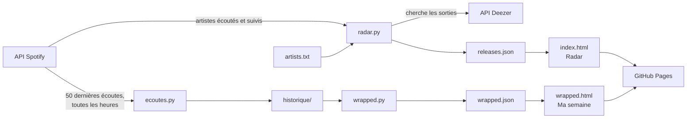

# radar-musique

Un site perso autour de ma musique, mis à jour automatiquement à partir de mon compte Spotify :

- **Radar** : les sorties des 7 derniers jours (albums, EP, singles) des artistes que j'écoute.
- **Ma semaine** : mon wrapped de la semaine, avec mes minutes d'écoute, mes tops, mes découvertes et mes habitudes d'écoute.

**Le site : https://antoinelongour.github.io/radar-musique/**

## Ce que fait le site

### Radar

- Affiche les sorties de la semaine, regroupées par jour, avec la pochette, le titre et les artistes.
- Filtre par type : albums, EP ou singles.
- Ouvre la sortie sur Spotify en un clic.
- Retire les doublons : versions multiples d'un même titre, featurings entre artistes suivis, singles déjà présents sur l'album de la semaine.

### Ma semaine

- Minutes d'écoute et nombre d'écoutes, comparés à la semaine précédente (ou au même moment de la semaine précédente quand la semaine est en cours).
- Top 5 artistes, avec leur évolution dans le classement (▲, ▼, = ou « Nouveau »), et top 5 titres.
- Minutes par jour et écoutes par heure, avec un tableau des chiffres.
- Découvertes : les artistes jamais écoutés depuis le début de la collecte.
- Navigation entre les semaines. Par défaut, la page s'ouvre sur la dernière semaine terminée.

## Comment ça marche



Deux automatisations GitHub Actions font tourner le tout :

| Automatisation | Quand | Ce qu'elle fait |
|---|---|---|
| **Collecte des écoutes** (`ecoutes.yml`) | Toutes les heures | Récupère les 50 dernières écoutes sur Spotify et range les nouvelles dans `historique/`, un fichier par semaine. Elle enregistre ces fichiers dans le repo (commits de `github-actions[bot]`). |
| **Radar du vendredi** (`radar.yml`) | Chaque matin vers 6 ou 7 h (heure de Paris), à chaque push, ou à la main | Lance `radar.py` et `wrapped.py`, puis publie les deux pages sur GitHub Pages. |

Pourquoi collecter toutes les heures ? Spotify ne garde que les 50 dernières écoutes. Pour construire un historique, il faut les relever avant qu'elles disparaissent.

Pourquoi Deezer pour les sorties ? Depuis février 2026, l'API Spotify en mode développeur ne propose plus la liste des nouveautés, et Deezer reçoit les sorties directement des labels, le jour même.

## Fichiers du projet

| Fichier | Rôle |
|---|---|
| `radar.py` | Récupère les artistes (Spotify et `artists.txt`), cherche leurs sorties sur Deezer, écrit `releases.json`. |
| `index.html` | La page Radar. |
| `releases.json` | Les sorties de la semaine, générées par `radar.py`. |
| `artists.txt` | Artistes ajoutés à la main, un par ligne. Toujours pris en compte, même sans Spotify. |
| `ecoutes.py` | Collecte les écoutes récentes et les range dans `historique/`. |
| `historique/` | Toutes les écoutes collectées, un fichier JSON par semaine (`2026-S43.json`, etc.). Rempli automatiquement. |
| `wrapped.py` | Calcule les statistiques de chaque semaine à partir de `historique/`, écrit `wrapped.json`. |
| `wrapped.html` | La page Ma semaine. |
| `wrapped.json` | Les statistiques de chaque semaine, générées par `wrapped.py`. |
| `spotify_token.py` | Script à lancer une fois (puis tous les 6 mois) pour autoriser l'accès à Spotify. |
| `requirements.txt` | Les bibliothèques Python nécessaires (`requests`, `tzdata`). |
| `.github/workflows/` | Les deux automatisations : `radar.yml` et `ecoutes.yml`. |

## Configurer Spotify

Le radar fonctionne sans Spotify (il utilise alors seulement `artists.txt`). La collecte des écoutes et la page Ma semaine, elles, ont besoin de Spotify.

### Les trois clés

| Nom | Ce que c'est | Secret ? |
|---|---|---|
| **Client ID** | L'identifiant de l'app Spotify. | Non, il apparaît même dans le lien d'autorisation. |
| **Client secret** | Le mot de passe de l'app. | **Oui.** |
| **Refresh token** | La clé longue durée qui permet aux scripts de lire mes données Spotify sans que je me reconnecte. Elle expire au bout de 180 jours. | **Oui.** |

Avec le Client secret et le refresh token, n'importe qui pourrait lire mes données Spotify. Ils ne doivent jamais être écrits dans un fichier du repo. Ils sont rangés dans les secrets GitHub, que GitHub donne aux automatisations sans jamais les afficher.

Les droits demandés sont en lecture seule :

- `user-top-read` : artistes les plus écoutés ;
- `user-follow-read` : artistes suivis ;
- `user-read-recently-played` : écoutes récentes.

### Étapes

1. **Créer l'app** sur [developer.spotify.com/dashboard](https://developer.spotify.com/dashboard) (un compte Spotify Premium est nécessaire pour le mode développeur) :
   - Redirect URI : `http://127.0.0.1:8888/callback` (Spotify refuse `localhost`)
   - API utilisée : **Web API**
2. **Récupérer le refresh token** :
   ```
   python spotify_token.py
   ```
   Le script demande le Client ID et le Client secret, affiche un lien d'autorisation, puis demande de coller l'adresse complète de la page d'erreur obtenue après avoir accepté (elle contient `?code=...&state=...`). Il vérifie l'accès aux artistes et aux écoutes, puis affiche le refresh token.
3. **Ajouter les secrets** dans le repo GitHub : **Settings** → **Secrets and variables** → **Actions** → **New repository secret** :
   - `SPOTIFY_CLIENT_ID`
   - `SPOTIFY_CLIENT_SECRET`
   - `SPOTIFY_REFRESH_TOKEN`
4. **Lancer les automatisations** : **Actions** → **Collecte des écoutes** → **Run workflow**, puis **Radar du vendredi** → **Run workflow**.

### Renouveler la clé (tous les 6 mois)

Le refresh token expire au bout de 180 jours. Quand c'est le cas, la collecte échoue (GitHub envoie un e-mail) et la page Radar affiche un message. Pour réparer : relancer `python spotify_token.py`, puis remplacer la valeur du secret `SPOTIFY_REFRESH_TOKEN` sur GitHub.

Si le Client secret a été changé (bouton **Rotate client secret** sur Spotify), il faut aussi mettre à jour `SPOTIFY_CLIENT_SECRET`.

## Travailler sur le projet

- Le robot de collecte ajoute des commits toutes les heures. Avant de modifier quoi que ce soit : `git pull`.
- Si un push est refusé (« rejected… fetch first ») : `git pull` puis `git push`.
- Réglage conseillé, à faire une seule fois : `git config --global pull.rebase true`.
- Pour relancer une automatisation, utiliser **Run workflow** et pas **Re-run**, sinon la publication échoue (« Multiple artifacts named github-pages »).

## Lancer le projet en local

```
pip install -r requirements.txt
python radar.py
python wrapped.py
python -m http.server 8000
```

Puis ouvrir `http://localhost:8000`. Sans les variables d'environnement Spotify, `radar.py` utilise seulement `artists.txt`. `ecoutes.py` ne tourne que sur GitHub, où se trouvent les secrets : faire un `git pull` pour récupérer les dernières écoutes avant de lancer `wrapped.py`.

## Confidentialité

- Les clés Spotify ne sont jamais dans le code : elles sont dans les secrets GitHub, chiffrées et masquées dans les logs.
- Si le repo est public, `historique/` l'est aussi : chaque morceau écouté, avec l'heure exacte. Les pages publiées, elles, ne montrent que des statistiques.
- Pour rendre le repo privé tout en gardant le site, il faut GitHub Pro (gratuit avec le GitHub Student Developer Pack). Sans Pro, passer le repo en privé désactive GitHub Pages. En le repassant en public, il faut le réactiver dans **Settings** → **Pages** → **Source : GitHub Actions**.

## Limites connues

- **Rééditions** : Deezer donne la date de mise en ligne, pas la date d'origine. Une réédition d'un vieil album apparaît donc comme une nouveauté.
- **Noms différents** : un artiste n'est retenu sur Deezer que s'il y est écrit exactement comme sur Spotify (aux accents et majuscules près), pour éviter les homonymes. Les artistes non trouvés sont listés dans les logs de l'étape « Lancer le radar ».
- **Écoutes manquées** : si plus de 50 morceaux sont écoutés entre deux collectes, ou si GitHub retarde une collecte de plusieurs heures, les plus anciens sont perdus. Les écoutes en session privée ne sont pas enregistrées par Spotify.
- **Minutes approximatives** : Spotify donne la durée de chaque morceau, pas le temps réellement écouté. Un morceau zappé en cours de route compte pour sa durée entière.
- **Première semaine incomplète** : la collecte a commencé en cours de semaine 43. Cette semaine sert de base pour les découvertes, mais pas pour les comparaisons.
- **Mise à jour du site** : une fois par jour et à chaque push. Pour voir la semaine en cours à jour : **Actions** → **Radar du vendredi** → **Run workflow**.

## Technologies

Python (`requests`), HTML, CSS et JavaScript sans bibliothèque, API Spotify Web, API Deezer, GitHub Actions, GitHub Pages.

Données des sorties fournies par Deezer, artistes et écoutes par Spotify.
